# Admin System with Payment Flow for AuctionHub

## Background

Currently, AuctionHub has a simple user model (register/login/bid/host auctions) with no financial system or admin controls. This plan adds:

1. **Admin role** with full control over the platform
2. **Wallet system** for every user
3. **Escrow payment flow** when auctions complete:
   - Winning bidder's money → Admin wallet
   - Admin deducts **platform fee (5%)** + **processing charges (2%)** = **7% total**
   - Remaining **93%** sent to the auction host
   - All losing bidders get their bid amounts **refunded** to their wallets

---

## User Review Required

> [!IMPORTANT]
> **Platform Fee Configuration**: The plan uses **5% platform fee + 2% processing charge = 7% total deduction**. Let me know if you want different percentages.

> [!IMPORTANT]
> **Admin Account Creation**: The plan creates a default admin account on first run with username `admin` and password `admin123`. You should change this immediately after first login.

> [!WARNING]
> **This is a simulated wallet system** — no real payment gateway (Razorpay, Stripe, etc.) is integrated. Users "add funds" to their wallet via a form, and all transactions are recorded in the database. If you want real payment gateway integration later, the wallet architecture supports it.

## Open Questions

1. **Should bidders be required to have sufficient wallet balance before placing a bid?** (i.e., their bid amount is "held" / escrowed when they bid) — The current plan **holds/escrows** the bid amount when a bid is placed, and refunds the previous top bidder immediately.

2. **Should the admin be able to cancel auctions mid-flight?** The plan includes this capability.

3. **Should there be a "Add Funds" page for users to top up their wallet?** The plan includes this.

---

## Proposed Changes

### Database Schema Changes

#### [MODIFY] [app.py](file:///c:/Users/bharg/Desktop/projects/AuctionHub/app.py)

Add new tables and modify existing ones in `init_db()`:

**New/Modified Tables:**

| Table | Purpose |
|-------|---------|
| `users` — add `role` column | `'user'` (default) or `'admin'` |
| `users` — add `wallet_balance` column | Current available balance (REAL, default 0.0) |
| `wallets` (NEW) | Transaction ledger: every credit/debit recorded |
| `platform_settings` (NEW) | Configurable platform fee %, processing fee % |

**`wallets` table schema:**
```sql
CREATE TABLE IF NOT EXISTS wallets (
    id            INTEGER PRIMARY KEY AUTOINCREMENT,
    user_id       INTEGER NOT NULL,
    amount        REAL NOT NULL,
    type          TEXT NOT NULL,  -- 'credit' or 'debit'
    description   TEXT,
    reference_id  INTEGER,       -- auction_id or bid_id
    created_at    TIMESTAMP DEFAULT CURRENT_TIMESTAMP,
    FOREIGN KEY (user_id) REFERENCES users(id)
);
```

**Auction completion payment flow columns:**

| Column on `auctions` | Purpose |
|-----------------------|---------|
| `winner_id` | The winning bidder's user ID |
| `final_price` | Winning bid amount |
| `platform_fee` | Amount deducted as platform fee |
| `processing_fee` | Amount deducted as processing charge |
| `host_payout` | Net amount sent to host |
| `settled` | Boolean — whether payment has been distributed |

---

### Backend Routes (app.py)

#### [MODIFY] [app.py](file:///c:/Users/bharg/Desktop/projects/AuctionHub/app.py)

**New decorators:**
- `admin_required` — checks `session['role'] == 'admin'`

**New API/page routes:**

| Route | Method | Purpose |
|-------|--------|---------|
| `/admin` | GET | Admin dashboard page |
| `/admin/users` | GET | List all users with management controls |
| `/admin/auctions` | GET | List all auctions with management controls |
| `/admin/transactions` | GET | View all wallet transactions |
| `/admin/user/<id>/toggle` | POST | Activate/deactivate a user |
| `/admin/user/<id>/make-admin` | POST | Promote user to admin |
| `/admin/auction/<id>/cancel` | POST | Force-cancel an auction |
| `/admin/settings` | GET/POST | View/update platform fee settings |
| `/api/admin/stats` | GET | Dashboard stats (JSON) |
| `/api/admin/users` | GET | Users list (JSON) |
| `/api/admin/transactions` | GET | Transactions list (JSON) |
| `/wallet` | GET | User's wallet page |
| `/wallet/add-funds` | POST | Add funds to wallet |
| `/api/wallet` | GET | Wallet data (JSON) |

**Modified logic:**

- **`place_bid()`**: Check wallet balance ≥ bid amount → debit bid amount from bidder's wallet (escrow) → if there was a previous top bidder, refund their escrowed amount
- **`complete_expired()`**: When auction ends → transfer winning amount to admin → calculate fees → credit host with net amount → refund all losing bidders
- **`login()`**: Store `role` in session
- **`register()`**: Default role = `'user'`
- **`api_user_status()`**: Include `role` in response

---

### Frontend — Admin Dashboard

#### [NEW] [admin_dashboard.html](file:///c:/Users/bharg/Desktop/projects/AuctionHub/templates/admin_dashboard.html)

Full admin dashboard with tabs:
- **Overview** — total users, total auctions, active auctions, total revenue, platform earnings
- **Users** — table with all users, role badges, activate/deactivate toggle, promote to admin
- **Auctions** — table with all auctions, status, winner, settle status, cancel button
- **Transactions** — full ledger of all wallet transactions with filters
- **Settings** — configure platform fee % and processing charge %

Design: Matches existing dark gold aesthetic with glassmorphism cards, data tables, and stat tiles.

---

### Frontend — Wallet Page

#### [NEW] [wallet.html](file:///c:/Users/bharg/Desktop/projects/AuctionHub/templates/wallet.html)

User-facing wallet page showing:
- Current balance
- Add funds form
- Transaction history (credits/debits with descriptions)

---

### Navigation Updates

#### [MODIFY] All templates with navbar

- Add "Admin" link (visible only to admin users) in the navbar
- Add "Wallet" link with balance badge for logged-in users
- Update profile dropdown to show role (Admin/Member)

---

### CSS Styles

#### [MODIFY] [style.css](file:///c:/Users/bharg/Desktop/projects/AuctionHub/static/css/style.css)

Add styles for:
- Admin dashboard layout (stat cards, data tables, tab navigation)
- Wallet page
- Role badges (admin gold crown, member blue)
- Transaction history entries
- Admin action buttons (danger buttons for cancel/deactivate)

---

### JavaScript

#### [MODIFY] [dynamic_ui.js](file:///c:/Users/bharg/Desktop/projects/AuctionHub/static/js/dynamic_ui.js)

Add:
- `initAdminDashboard()` — load stats, users, auctions, transactions via API
- `initWallet()` — load wallet balance and transaction history
- Update `updateAuthUI()` to handle admin role display
- Tab switching logic for admin dashboard

---

## Payment Flow Diagram

```mermaid
sequenceDiagram
    participant B as Bidder (Winner)
    participant LB as Losing Bidders
    participant A as Admin Wallet
    participant H as Host

    Note over B: Places bid → amount escrowed from wallet
    Note over LB: Previous top bidder → refunded immediately

    rect rgb(40, 44, 60)
        Note over B,H: Auction Ends
        B->>A: Winning bid amount (₹1000)
        A->>A: Deduct Platform Fee 5% (₹50)
        A->>A: Deduct Processing Fee 2% (₹20)
        A->>H: Net Payout 93% (₹930)
        LB->>LB: All losing bids refunded to wallets
    end
```



---

## Verification Plan

### Manual Verification
1. Create admin account, login, verify dashboard access
2. Register regular users, verify they cannot access admin routes
3. Add funds to wallet, place bids, verify escrow deductions
4. Let auction expire, verify:
   - Winner's escrowed amount stays deducted
   - Admin wallet gets credited
   - Host gets 93% of winning bid
   - Losing bidders get full refunds
5. Test admin user management (activate/deactivate, promote)
6. Test admin auction cancellation (all bidders refunded)
7. Verify transaction ledger accuracy

### Automated Tests
- `python -c "import app; app.init_db(); print('DB init OK')"` — verify schema migrations work
